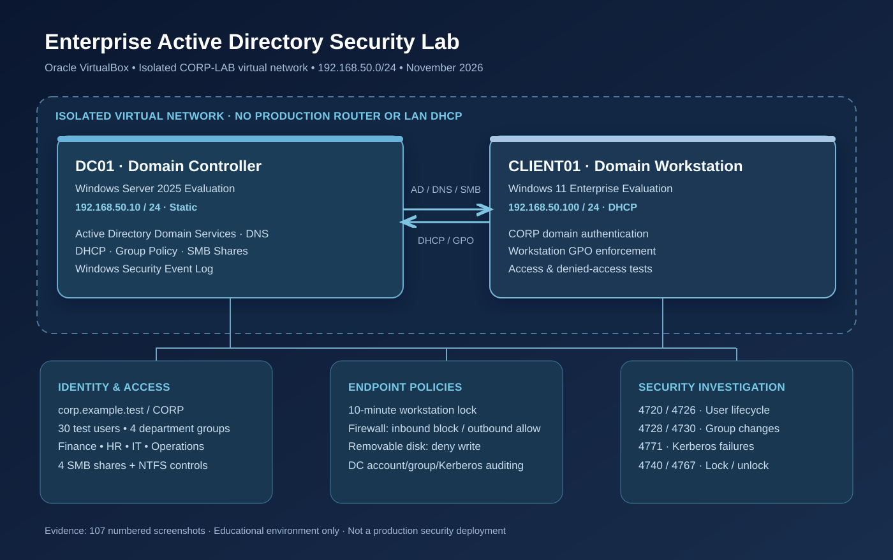

# Enterprise Active Directory Security & Administration Lab

**Windows Server 2025 · Active Directory · PowerShell · GPO · SMB/NTFS · DNS/DHCP · Windows Security event investigation**

Built an isolated fictional corporate network in VirtualBox with a Windows Server domain controller, Windows 11 domain client, 30 original employee accounts, departmental access controls, network services, workstation policies and a controlled authentication incident. Later investigations added read-only account reconciliation, deeper DNS traces, four-department user-permission tests, and a **separate isolated clone** for testing safer employee-provisioning automation.

> **Training lab, not production.** All accounts, support tickets, and security incidents are simulated. No real organization or customer is involved. The original lab remained at **30** users; a **disconnected clone** reached **34** after four disabled demo accounts were created.

## Results backed by actual tests

| Area | Observed result | Evidence |
|---|---|---|
| Domain and roster | `corp.example.test`; 30 original users; group counts IT 8, HR 7, Finance 8, Operations 7 | [User count](screenshots/0092-active-directory-30-user-verification.png) · [Group counts](screenshots/0093-active-directory-security-group-verification.png) · [Live reconciliation](screenshots/0105-live-account-reconciliation.png) |
| Configuration verification | **21 read-only checks**, zero mismatch, zero section errors (within script's scope) | [Verification](screenshots/0101-live-active-directory-verification.png) · [Saved transcript](screenshots/0102-live-verification-output-saved.png) |
| Workstation | CLIENT01 domain-joined; domain logins verified; three security GPOs applied | [Domain join](screenshots/0034-client01-domain-join-success.png) · [Applied GPOs](screenshots/0131a-usb-restriction-gpo-applied.png) |
| Effective file access | Four representative accounts × four shares = **16 directory checks** (4 allowed, 12 denied); four permitted file create/read checks and four denied cross-share write attempts | [IT](screenshots/0127a-it-employee-share-access-test.png) · [HR](screenshots/0128d-hr-employee-share-access-test.png) · [Finance](screenshots/0129a-finance-employee-share-access-test.png) · [Operations](screenshots/0130a-operations-employee-share-access-test.png) |
| Simulated help desk | HR employee password reset through ADUC, successful login and effective share access verification | [Reset](screenshots/0128b-hr-password-reset-confirmation.png) · [Final checks](screenshots/0128f-hr-unauthorized-write-and-cleanup.png) |
| DNS investigation | Verified local A/PTR, detected suffix-expanded query, captured/exported 148 packets with zero dropped; **timeout root cause not proven** | [Debug trace](screenshots/0110b-dns-suffix-debug-part1.png) · [Packet export](screenshots/0116-dns-packet-capture-saved.png) |
| USB restriction | GPO applied and `Deny_Write=0x1` seen; **actual USB write attempt not performed** | [Policy](screenshots/0131a-usb-restriction-gpo-applied.png) · [Registry](screenshots/0131b-usb-write-restriction-registry-verified.png) |
| Secure provisioning | Separate clone: plan-only and WhatIf unchanged at 30 users; four disabled users created with correct group membership; clone count 34; rerun plan `ALREADY_CORRECT` | [WhatIf](screenshots/0132g-provisioning-whatif-safety-test.png) · [Apply](screenshots/0132h-isolated-clone-provisioning-execution.png) · [Final checks](screenshots/0132i-provisioning-final-verification.png) |
| Security event analysis | Simulated account/group changes, Kerberos failure Event 4771, account lockout 4740 and unlock 4767 | [Kerberos 4771](screenshots/0080a-kerberos-failed-authentication-event.png) · [Lockout](screenshots/0085-account-lockout-event-4740-investigation.png) · [Unlock](screenshots/0086-account-unlock-and-security-event-verification.png) |

## Lab architecture

| Component | Configuration |
|---|---|
| Original network | VirtualBox **Internal Network** `CORP-LAB` |
| Domain controller | DC01, Windows Server 2025 Evaluation, `192.168.50.10/24` |
| Windows client | CLIENT01, Windows 11 Enterprise Evaluation, DHCP `192.168.50.100/24` |
| Domain | `corp.example.test` / `CORP` |
| Directory | Company OU, IT/HR/Finance/Operations sub-OUs, Workstations OU |
| Files | `\\DC01\IT`, `\\DC01\HR`, `\\DC01\Finance`, `\\DC01\Operations` |
| Share/NTFS policy | Department groups: SMB Change / NTFS Modify; administrators: Full |
| DHCP/DNS | Scope `192.168.50.100–200`; client DNS `192.168.50.10` |
| Workstation policy | 600-second inactivity setting, firewall default inbound Block, USB deny-write configuration |
| Provisioning clone | Separate VM on **`CORP-LAB-TEST`**, never connected to original domain LAN during clone tests |

The original lab places DHCP and SMB shares on the domain controller to fit the two-VM design. A real deployment would isolate file-server workloads, implement backup/restore and use additional domain controllers where needed. See [architecture decisions](diagrams/architecture.md).

## Technical documentation

| Focus | Investigation / report |
|---|---|
| Domain setup and original onboarding | [Server foundation](documentation/01-environment-and-domain-controller.md) · [AD structure](documentation/02-active-directory-structure-and-automation.md) · [Bulk onboarding](documentation/04-bulk-provisioning-and-validation.md) |
| Original domain and live verification | [30-user reconciliation and 21 checks](documentation/11-live-roster-and-integrity-verification.md) |
| Domain workstation and GPO | [CLIENT01 domain join](documentation/03-client-domain-join.md) · [Workstation security policies](documentation/05-workstation-group-policy-security.md) |
| SMB/NTFS and user permissions | [Access-control design](documentation/06-department-file-shares-and-access-control.md) · [Four-user access matrix](documentation/13-department-access-control-follow-up.md) |
| Support ticket | [AD-001: fictional HR account password reset](documentation/support-tickets/AD-001-hr-password-reset.md) |
| DHCP and DNS | [Original repair](documentation/07-dhcp-and-dns-troubleshooting.md) · [Packet/suffix investigation](documentation/12-dns-follow-up-investigation.md) |
| Security operations | [Audit controls](documentation/08-security-auditing-and-event-validation.md) · [Kerberos / lockout](documentation/09-authentication-and-account-lockout-incident.md) |
| New PowerShell provisioning | [Isolated clone runtime proof](documentation/14-isolated-provisioning-validation.md) · [Scripts guide](scripts/README.md) |
| Verification | [Control matrix and limits](documentation/10-verification-and-limitations.md) · [Reviewer checklist](documentation/reviewer-verification-checklist.md) |

**Browse [all 174 screenshots](documentation/evidence-index.md)** in four-digit order. The original milestone numbers and letter suffixes were kept. The unprovided step `0117` was not manufactured.

## Source-code provenance and safe use

The original [`Create-Employees-v3.ps1`](scripts/historical/Create-Employees-v3.ps1) and historical [28-row `employees.csv`](scripts/historical/employees.csv) are archived separately from later reference implementations. Two separately created users, `amorgan` and `sjohnson`, complete the original 30-account roster; a **live read-only reconciliation** verified it.

The newer [`Invoke-LabEmployeeProvisioning.ps1`](scripts/Invoke-LabEmployeeProvisioning.ps1) uses a strict [CSV validator](scripts/EmployeeCsv.Validation.psm1), plans changes **without `-Apply`**, previews changes with `-Apply -WhatIf`, and creates **disabled, passwordless** accounts only when write-mode is explicitly approved. Its real AD happy path was tested on the **isolated clone only**. Mock failure-path tests in [`Test-ProvisioningSafety.ps1`](tests/Test-ProvisioningSafety.ps1) run offline; they do not establish production suitability or all real AD failure scenarios.

The newer [`Verify-Lab.ps1`](scripts/Verify-Lab.ps1) and [`Test-LabRoster.ps1`](scripts/Test-LabRoster.ps1) produced the captured live DC01 read-only results. [`Analyze-AuthenticationEvents.ps1`](scripts/Analyze-AuthenticationEvents.ps1) has synthetic tests but is not represented as a deployed monitoring system. Previous [GitHub Actions tests](https://github.com/raheem-code124/active-directory-security-lab/actions) cover synthetic/structural checks, not a live domain.

## Known limits and lessons

- **DNS:** PTR/server-name lookup was repaired, while some ordinary `nslookup` timeouts persisted. Later suffix-debug and packet-capture evidence refined hypotheses but did **not** conclusively prove the cause or a lasting fix.
- **USB:** An applied GPO and registry value are **not proof** that a physical USB write was blocked; that behavioral test was skipped due to available hardware.
- **Access matrix:** Four representative users were tested, not all 30; directory listing covered all 16 user/share combinations while unauthorized write tests targeted one other share per user.
- **Inactivity:** The 600-second setting and lock screen were captured, but independent elapsed-time measurement was not recorded.
- **Infrastructure:** No redundant DC, restore exercise, SIEM, EDR, production file server, or deployed alerting pipeline was tested.
- **Clone:** The four additional demonstration accounts are **only on the isolated VM copy**, which must never be connected to the original internal domain network with the duplicate DC identity.
- **Privacy:** Repository visibility remains **private** pending a manual inspection of each screenshot and archived code for exposed secrets; successful link checks cannot replace that review.

The project is documented as an evidence-backed training exercise. Claims distinguish actual command results from mock tests, planned procedures and unresolved findings.
