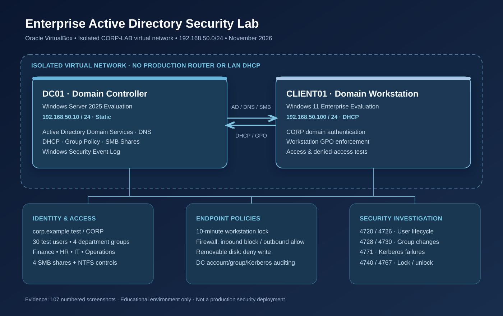
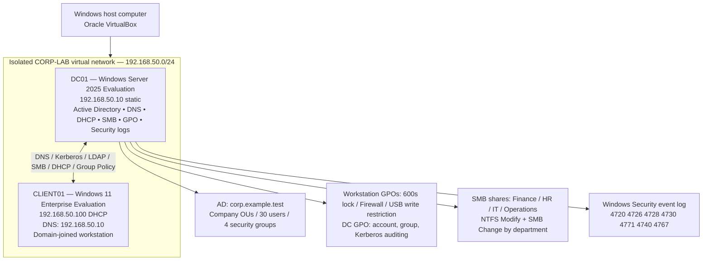

# Network and security architecture

[← Main README](../README.md) · [Configuration reference](../documentation/configuration-reference.md) · [Open SVG diagram](architecture.svg)

## Editable Mermaid diagram

## Explanation

1. **VirtualBox host:** Runs two lab virtual machines. The `CORP-LAB` virtual network keeps the Windows DHCP and domain services away from the physical/home network.
2. **DC01:** Central server. Holds the single domain's directory accounts, publishes DNS, leases IPv4 addresses, stores four departmental SMB shares, and records domain security events.
3. **CLIENT01:** Joined to `corp.example.test`. Employee accounts authenticate to the domain, receive machine GPOs, and access authorized departmental file shares.
4. **RBAC:** Security groups are the bridge between department membership and shared-folder permissions. Users do not receive broad access to all departmental folders.
5. **Incident response:** Failed authentication originates at CLIENT01 and is observable in DC01's security log. A test fine-grained password policy was created and removed after the account-lockout exercise.

### Boundary and scope

This is an educational two-VM layout. There is **no** production firewall appliance, gateway, internet routing configuration, redundant DC, SIEM, or external identity provider. The diagram deliberately omits those items. The demonstrated client IP is the DHCP-assigned `192.168.50.100`; an earlier static client address was used during setup.

### Ports and protocols (conceptual, not a packet capture)

- DNS typically uses UDP/TCP 53.
- Kerberos authentication commonly uses UDP/TCP 88.
- LDAP/Active Directory traffic commonly uses TCP/UDP 389.
- SMB file access normally uses TCP 445.
- DHCP IPv4 uses UDP 67/68.

These are protocol reference values, **not** a claim that every port was individually tested or packet-captured.
